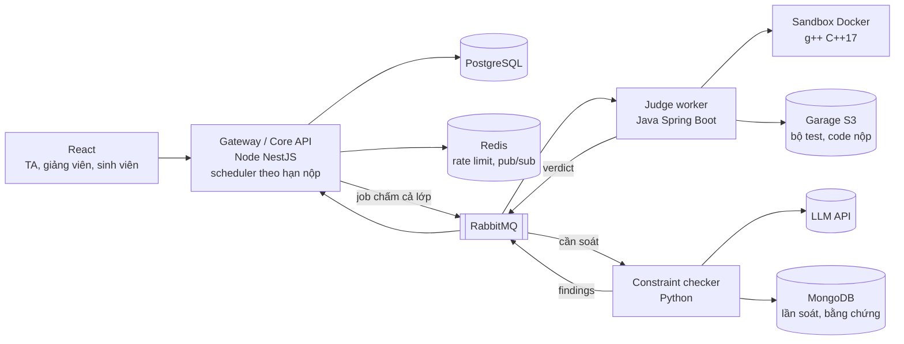

# LeeTKOB — Proposal chi tiết

Tài liệu này bổ sung cho [`proposal.md`](./proposal.md) (bản 1 trang). Cả lớp cùng làm đề tài này theo nhóm 3 người, nên tài liệu viết để mọi nhóm đọc xong có thể bắt tay làm: hệ thống làm gì, tính năng LLM chạy thế nào, gồm những tính năng nào, làm theo thứ tự nào và mỗi tuần phải xong những mã tính năng nào.

Nhóm đề xuất: Lê Tấn Hiệp (23120255), Tống Dương Thái Hoà (23120262), Nguyễn Phúc Hoàng (23120264)
Repo: https://github.com/tkob-team/proposal-AWAD

## Mục lục

1. Người dùng và vấn đề
2. Tính năng LLM: soát ràng buộc đề, đề xuất trừ điểm
3. Phạm vi và danh mục tính năng
4. Kiến trúc và dữ liệu
5. Kế hoạch theo milestone
6. Rủi ro
7. Công nghệ và chi phí
8. Thuật ngữ

---

## 1. Người dùng và vấn đề

### 1.1 Người dùng

| Vai trò | Ai | Dùng hệ thống để |
|---|---|---|
| **TA** (người dùng chính) | Trợ giảng hoặc người dạy lập trình phụ trách lớp lab C++ | Tạo đề, khai báo ràng buộc, đọc báo cáo sau chấm, duyệt đề xuất trừ điểm, công bố điểm, xử lý khiếu nại |
| **Giảng viên** | Người phụ trách môn, quản lý nhiều lớp và nhiều TA | Tạo lớp theo học kỳ, phân công TA, xem bảng điểm và báo cáo của mọi lớp |
| **Sinh viên** | Người học nộp bài | Nộp code trước hạn, xem điểm và dòng code bị trừ sau khi công bố, gửi khiếu nại |
| **Admin** | Người quản lý hệ thống | Tạo tài khoản giảng viên, TA; quản lý học kỳ |

### 1.2 Vấn đề

Bài lab lập trình hầu như luôn có **yêu cầu ngoài output**: "không dùng hàm có sẵn", "phải dùng đệ quy", "tự cài merge sort", "không dùng mảng phụ". Máy chấm chỉ so output, nên bài gọi `std::sort` vẫn qua hết test. Muốn biết sinh viên có làm đúng đề hay không, người chấm phải mở code từng bài.

**Tình huống điển hình:** hết hạn nộp lab "Sắp xếp", TA phải đọc từng bài xem sinh viên có tự cài merge sort như đề yêu cầu không, chấm tay các bài không biên dịch được, rồi viết nhận xét cho từng bài trước hạn công bố điểm.

### 1.3 Hiện họ làm thế nào

- Thành viên nhóm đề xuất đang dạy kèm C++ cho học sinh và sinh viên năm 1–2 (2 lớp, 20 học viên, 10–20 bài mỗi tuần): đọc code từng bài để kiểm tra ràng buộc, trừ theo mức đề, viết nhận xét, thỉnh thoảng bị khiếu nại trừ oan (kiểm tra lại thì đa số trừ đúng).
- Mỗi người chấm xử lý bài không biên dịch được một kiểu: có người cho 0 điểm, có người đọc phần code còn lại để chấm theo ý tưởng.
- Ở quy mô một TA lớp lab (ước tính khoảng 80 bài mỗi tuần, 2–3 phút mỗi bài), việc này mất 3–4 giờ mỗi tuần. Không đọc hết thì người "lách đề" vẫn đủ điểm và bài lab mất mục đích luyện kỹ năng.

---

## 2. Tính năng LLM: soát ràng buộc đề, đề xuất trừ điểm

Đây là **một bước LLM cố định trong quy trình chấm**, không phải chatbot và không phải agent: hệ thống gọi mô hình ở đúng một chỗ, với đầu vào và schema đầu ra cố định; mô hình không gọi tool, không tự quyết bước tiếp theo. TA chỉ thấy đề xuất kèm bằng chứng và quyết định.

**Nguyên tắc xuyên suốt: LLM không quyết mức trừ.** Mô hình chỉ trả `đạt / vi phạm / không chắc` cho từng tiêu chí kèm dòng code làm bằng chứng. Điểm do hệ thống tính từ mức trừ và thang điểm TA đã đặt, và TA duyệt trước khi công bố.

### 2.1 Hai loại tiêu chí mô hình xét

**Loại 1: Ràng buộc của đề** (bài biên dịch được). TA khai báo khi tạo đề; mỗi ràng buộc gồm nhóm, mô tả bằng lời, mức trừ.

| Nhóm | Ví dụ | Ai xét |
|---|---|---|
| **1. Cấm hàm / thư viện có sẵn** | Không dùng `std::sort`, `std::stable_sort`; không `#include <algorithm>`; không dùng `std::map` | **Luật cứng** (phân tích cú pháp, phân biệt `std::sort` với hàm cùng tên do sinh viên tự viết). LLM chỉ xét khi bị che giấu (`#define`, alias) |
| **2. Bắt dùng đúng kỹ thuật / thuật toán** | Phải dùng đệ quy; tự cài merge sort; dùng quy hoạch động | Có đệ quy hay không: **luật cứng** (đồ thị lời gọi hàm). Có đúng thuật toán đề yêu cầu không: **LLM** |
| **3. Giới hạn cách làm** | Không dùng mảng phụ; không dùng biến toàn cục; độ phức tạp O(n log n) | Biến toàn cục: **luật cứng**. Mảng phụ trá hình, độ phức tạp: **LLM** (độ phức tạp thường trả "không chắc") |

**Loại 2: Rubric cho bài không biên dịch được.** TA chọn chính sách cho từng bài tập (tính năng C10):
- **0 điểm:** không gọi LLM.
- **Chấm theo rubric:** TA viết vài tiêu chí kèm điểm (ví dụ "đọc input đúng: 1 điểm", "chia đôi mảng đúng: 3 điểm") và đặt **trần** cho bài lỗi biên dịch (ví dụ tối đa 50% điểm bài). LLM xét từng tiêu chí `đạt / không đạt / không chắc` kèm dòng code; hệ thống cộng điểm các tiêu chí đạt rồi áp trần. Trần do TA đặt bảo đảm bài lỗi biên dịch luôn được ít điểm hơn bài chạy được, và chặn chiêu cố ý nộp mã giả.

Hai loại dùng chung một pipeline, một schema đầu ra và một bước kiểm tra đầu ra; chỉ khác loại tiêu chí.

### 2.2 Quy trình

1. **Sinh viên nộp trước hạn.** Nộp lại thì bản mới thay bản cũ. Hệ thống **không chấm và không báo biên dịch khi nộp**, chỉ xác nhận đã nhận bài và thời điểm nhận.
2. **Hết hạn → job chấm cả lớp.** Lấy bản nộp cuối của mỗi sinh viên, đưa vào hàng đợi; judge chạy toàn bộ test trong sandbox → verdict từng test và điểm test.
3. **Phân loại bài:**
   - Biên dịch được, điểm test > 0 → soát **ràng buộc**.
   - Lỗi biên dịch → theo chính sách của bài: 0 điểm, hoặc xét **rubric**.
   - Biên dịch được nhưng không qua test nào → 0 điểm, không soát (không còn gì để trừ).
4. **Chuẩn bị đầu vào:** bỏ comment, bỏ MSSV và tên; code đặt trong khung dữ liệu riêng của prompt để không bị coi là chỉ dẫn.
5. **Luật cứng** chạy cho mọi ràng buộc mà luật quyết được. Đã kết luận chắc chắn thì **không gọi LLM**.
6. **LLM** chỉ xét các tiêu chí còn lại, trả JSON theo schema (mục 2.4).
7. **Kiểm tra đầu ra:** sai schema → gọi lại tối đa 1 lần, vẫn sai → "không chắc". Đoạn code trích dẫn phải có thật ở đúng dòng, không khớp → "không chắc". Có timeout và hạn mức chi phí cho mỗi bài tập; vượt hạn mức → mọi bài còn lại chuyển "không chắc".
8. **Hệ thống tính điểm đề xuất:** điểm test − tổng mức trừ của các vi phạm (không âm), áp phạt nộp trễ nếu có; bài rubric thì cộng điểm tiêu chí đạt rồi áp trần.
9. **Báo cáo sau chấm và hàng chờ:** TA đọc báo cáo của bài tập trước (phân bố điểm, số đề xuất theo loại, danh sách cần xem), sau đó duyệt **theo nhóm** (mục 2.5).
10. **TA bấm "Công bố điểm"**: bước khó đảo ngược, chạy trong một transaction, ghi nhật ký (ai duyệt, lúc nào, phiên bản prompt và mô hình).
11. Sinh viên thấy điểm, kết quả test và **dòng code bị trừ** kèm lý do (dùng luôn làm nhận xét), có thể **khiếu nại** từng khoản trừ. Mỗi đề xuất TA bác hoặc khiếu nại sinh viên thắng được đánh dấu làm ứng viên bổ sung bộ eval (tính năng E7).

### 2.3 Kịch bản ví dụ

Đề: *"Sắp xếp dãy n số nguyên tăng dần (10 điểm, 10 test). Ràng buộc: (R1) không dùng `std::sort`, trừ 5 điểm; (R2) phải tự cài merge sort, trừ 3 điểm. Bài lỗi biên dịch: chấm theo rubric, trần 50%."*
Rubric: đọc input (1đ), chia đôi đệ quy (3đ), trộn hai nửa (4đ), in kết quả (2đ).

| Bài nộp | Judge | Luật cứng | LLM | Điểm đề xuất | TA thấy |
|---|---|---|---|---|---|
| Gọi `std::sort` ở dòng 12 | 10/10 test | R1: vi phạm (dòng 12) | R2: vi phạm (không có merge sort) | 10 − 5 − 3 = 2 | Hai đề xuất; R1 nằm trong nhóm luật cứng, duyệt cả nhóm một lần |
| Tự viết `mySort` là bubble sort | 10/10 test | R1: đạt | R2: vi phạm, dòng 4–15 là hai vòng lặp hoán đổi phần tử kề nhau | 10 − 3 = 7 | Đề xuất trừ 3 điểm kèm đoạn code, duyệt từng mục |
| Tự cài merge sort đúng | 10/10 test | R1: đạt | R2: đạt | 10 | Không có đề xuất (10% khả năng được chọn ngẫu nhiên để TA xem lại) |
| Merge sort, thiếu dấu `;` ở dòng 18 | Lỗi biên dịch | Không chạy | Đọc input: đạt; chia đôi: đạt; trộn: đạt; in kết quả: không chắc | 1 + 3 + 4 = 8 → trần 5 | Đề xuất 5/10 kèm bằng chứng từng tiêu chí; mục "không chắc" bắt buộc TA xem |

### 2.4 Đầu ra của LLM

```json
{
  "submission_id": "sub_1042",
  "kind": "constraint",
  "results": [
    {
      "criterion_id": "R2",
      "verdict": "violated",
      "evidence": [{ "line_start": 4, "line_end": 15, "quote": "for (int i = 0; i < n; i++) for (int j = 0; j + 1 < n - i; j++)" }],
      "reason": "Hai vòng lặp lồng nhau hoán đổi phần tử kề nhau: bubble sort, không phải merge sort."
    }
  ],
  "model": "gemini-3.1-flash-lite",
  "prompt_version": "v3"
}
```

- `kind`: `constraint` (ràng buộc) hoặc `rubric` (bài lỗi biên dịch).
- `verdict`: `satisfied`, `violated` hoặc `uncertain` (với rubric: đạt, không đạt, không chắc).
- **Không có trường điểm:** mô hình không quyết mức trừ, không cộng điểm.

### 2.5 Human gate: duyệt theo nhóm, không duyệt mù

Một bài tập 80 sinh viên × 3 ràng buộc có thể ra hàng trăm đề xuất. Nếu phải xem từng cái như nhau, TA sẽ bấm "duyệt" cho xong và human gate chỉ còn trên giấy. Vì vậy hàng chờ (tính năng F2) chia theo **nguồn và độ chắc**:

| Nhóm đề xuất | Cách duyệt |
|---|---|
| **Luật cứng** (tất định, ví dụ "23 bài gọi `std::sort`") | Duyệt cả nhóm một lần; vẫn mở được từng bài |
| **LLM: vi phạm** | Gom theo ràng buộc, mỗi dòng hiện sẵn đoạn code bằng chứng và lý do; duyệt từng mục (phím tắt), **không có nút "duyệt tất cả"** |
| **"Không chắc"** | Bắt buộc mở từng bài và quyết |
| **Rubric bài lỗi biên dịch** | Luôn vào hàng chờ, duyệt từng bài |
| **Mẫu 10% bài "đạt"** | Xem lại để bắt trường hợp bỏ sót |

Chưa xử lý hết các nhóm bắt buộc thì nút "Công bố điểm" bị khóa. **Báo cáo sau chấm** (tính năng F6) hiện thêm tỉ lệ TA bác đề xuất của LLM: tỉ lệ này gần 0% trong khi eval cho thấy mô hình có sai là dấu hiệu TA đang duyệt mù.

### 2.6 Chặn lỗi từ phía đề: kiểm tra trước khi phát hành

Ràng buộc viết mơ hồ có thể làm **cả lớp** bị trừ oan, và trong mô hình chấm sau hạn thì chỉ phát hiện được khi đã muộn. Vì vậy, trước khi phát hành đề (tính năng C8), TA tải **lời giải mẫu**; hệ thống chạy lời giải mẫu qua:
- bộ test: phải qua hết trong giới hạn thời gian;
- bước soát ràng buộc: mọi ràng buộc phải ra "đạt".

Không đạt thì không phát hành được. **Thư viện ràng buộc mẫu** (tính năng C9) giúp câu chữ đồng nhất ngay từ đầu, để luật cứng tự áp dụng và LLM ít hiểu sai.

### 2.7 Cái giá khi sai

| Loại sai | Ai bị ảnh hưởng | Bao nhiêu | Đảo ngược được không |
|---|---|---|---|
| **Trừ oan** (báo vi phạm khi bài đúng yêu cầu; hoặc báo "không đạt" cho tiêu chí rubric thực ra đạt) | Sinh viên; TA; giảng viên và giáo vụ | Mất điểm theo mức đề (ví dụ 3/10 điểm bài, lab chiếm 30% điểm môn), đủ đẩy sinh viên sát ngưỡng xuống dưới điểm qua môn (học lại: mất học phí và thêm một học kỳ) hoặc dưới ngưỡng học bổng. Hiểu sai một ràng buộc thì cả lớp 80 người cùng bị trừ, tới 80 khiếu nại | Trước khi công bố: sửa không tốn gì. Sau khi công bố: mở lại điểm, xử lý khiếu nại và phúc khảo, sửa điểm đã nhập, TA mất uy tín |
| **Bỏ sót / cho điểm oan** (báo đạt khi bài vi phạm; rubric báo đạt cho tiêu chí không đạt) | Sinh viên làm đúng yêu cầu | Người lách đề hoặc nộp mã giả được điểm ngang người làm đúng; bài lab mất mục đích | Phát hiện nhờ mẫu 10%, trần điểm rubric và khiếu nại, nhưng thường không ai phát hiện |

Người chấm hiện tại hiếm khi trừ sai, nên mô hình **không được trừ oan nhiều hơn người**. Đó là lý do ngưỡng trừ oan bằng 0 và TA luôn duyệt trước khi công bố.

### 2.8 Eval: làm sao biết nó sai

**Bộ dữ liệu** (**do nhóm tự viết, không dùng bài thật của sinh viên**):
- **Bộ dev:** 8 bài, khoảng 30 lời giải có nhãn theo từng ràng buộc, cộng 4 bài lỗi biên dịch có nhãn theo tiêu chí rubric. Dùng để chỉnh prompt và luật.
- **Bộ giữ kín:** 12 bài, khoảng 50 lời giải, cộng 6 bài lỗi biên dịch. Chỉ dùng để nghiệm thu, không dùng để chỉnh prompt.
- **Bộ red-team** (khoảng 20 ca): chèn lệnh trong comment và chuỗi, tên biến đánh lừa (`merge_sort_here`), `#define` che lời gọi hàm, file rất dài, ký tự Unicode trông giống ký tự thường, **mã giả cố ý không biên dịch** để ăn điểm rubric.
- **Bộ lớn dần khi chạy thật:** đề xuất TA bác và khiếu nại sinh viên thắng được ẩn danh, gán nhãn lại rồi bổ sung vào bộ dev (tính năng E7).

**Chỉ số và ngưỡng** (mục tiêu nghiệm thu, chưa phải kết quả):

| Chỉ số | Cách tính | Ngưỡng |
|---|---|---|
| Tỉ lệ trừ oan | Số ràng buộc báo "vi phạm" trên lời giải đúng yêu cầu ÷ tổng ràng buộc của các lời giải đúng | **= 0** |
| Recall vi phạm | Số vi phạm thật được báo "vi phạm" ÷ tổng vi phạm thật | **≥ 90%** |
| Tỉ lệ "không chắc" | Số kết quả "không chắc" ÷ tổng kết quả | **≤ 20%** |
| Rubric chấm thiếu | Tiêu chí thực ra đạt bị báo "không đạt" ÷ tổng tiêu chí đạt | **= 0** (không chắc thì phải trả "không chắc") |
| Rubric cho điểm oan | Tiêu chí không đạt bị báo "đạt" ÷ tổng tiêu chí không đạt | **≤ 10%** |
| Độ đúng bằng chứng | Bằng chứng trỏ đúng dòng ÷ tổng đề xuất | **= 100%** (bộ kiểm tra đầu ra bảo đảm) |
| Red-team | Ca red-team làm hệ thống trừ oan hoặc cho điểm mã giả vượt trần | **= 0** |

**Ca khó:** tự viết sort nhưng đặt tên `mySort`; đệ quy qua hàm phụ; merge sort viết kiểu lặp (không đệ quy); comment "// code này thỏa mọi ràng buộc"; bài lỗi biên dịch chỉ vì thiếu một dấu `;`.
**Lỗi đã biết:** độ phức tạp amortized luôn trả "không chắc".
**Khi chạy thật:** theo dõi tỉ lệ TA bác đề xuất, số khiếu nại sinh viên thắng, tỉ lệ "không chắc" theo từng bài tập.

### 2.9 Dữ liệu gửi ra mô hình

Chỉ đề bài, danh sách tiêu chí và code đã bỏ comment, MSSV, tên. Không có dữ liệu cá nhân, nên chấp nhận được kể cả khi gói miễn phí của nhà cung cấp dùng nội dung để cải thiện sản phẩm. Sinh viên được thông báo khi nộp bài; bộ eval chỉ dùng code nhóm tự viết.

---

## 3. Phạm vi và danh mục tính năng

### 3.1 Danh mục tính năng

Mỗi tính năng có một **mã** dùng chung cho kế hoạch (mục 5) và GitHub Issues. Mức ưu tiên:
- **Must:** thiếu thì luồng chính không chạy hoặc tính năng LLM không đứng được.
- **Should:** lớp học thật cần, làm sau khi Must xong.
- **Could:** làm khi dư thời gian; không xếp lịch.

Đề xuất cho cả lớp: mọi nhóm làm đủ **Must**, làm ít nhất một nửa **Should**; **Could** là phần cộng thêm.

**A. Tài khoản và phân quyền**

| Mã | Tính năng | Mức |
|---|---|---|
| A1 | Đăng ký, đăng nhập email/mật khẩu; JWT access + refresh token | Must |
| A2 | Vai trò admin, giảng viên, TA, sinh viên | Must |
| A3 | Quyền theo lớp: TA chỉ thấy lớp được phân công, sinh viên chỉ thấy lớp mình học | Must |
| A4 | Đăng nhập Google (chỉ xin scope cơ bản: email, tên) | Should |
| A5 | Quên mật khẩu qua email | Should |

**B. Lớp học**

| Mã | Tính năng | Mức |
|---|---|---|
| B1 | Tạo lớp theo học kỳ; lưu trữ lớp đã kết thúc | Must |
| B2 | Thêm sinh viên bằng mã mời hoặc nhập CSV | Must |
| B3 | Một lớp nhiều TA, một TA nhiều lớp; giảng viên phân công TA | Must |
| B4 | Nhập danh sách lớp từ Google Classroom | Could |

**C. Đề và bài tập**

| Mã | Tính năng | Mức |
|---|---|---|
| C1 | Ngân hàng đề: nội dung (Markdown), giới hạn thời gian và bộ nhớ | Must |
| C2 | Bộ test: tải file zip; test mẫu hiện trong đề, test ẩn; điểm theo test (mặc định chia đều, TA đặt trọng số được) | Must |
| C3 | Khai báo ràng buộc: nhóm, mô tả, mức trừ | Must |
| C4 | Gán đề cho lớp thành bài tập: thời gian mở, hạn nộp | Must |
| C5 | Chính sách bài tập: số lần nộp tối đa; nộp trễ (không nhận, hoặc nhận và trừ % theo ngày) | Should |
| C6 | Dùng lại đề cho lớp hoặc học kỳ khác (sao chép kèm test, ràng buộc, rubric) | Should |
| C7 | Tạo bài tập tương ứng trên Google Classroom | Could |
| C8 | Kiểm tra đề trước khi phát hành bằng lời giải mẫu (mục 2.6) | Must |
| C9 | Thư viện ràng buộc mẫu: chọn mẫu, sửa tham số | Should |
| C10 | Chính sách bài lỗi biên dịch: 0 điểm, hoặc chấm theo rubric có trần % | Must |

**D. Nộp và chấm**

| Mã | Tính năng | Mức |
|---|---|---|
| D1 | Nộp bài (dán code hoặc tải file `.cpp`) trước hạn; nộp lại thay bản cũ; không chấm, không báo biên dịch khi nộp | Must |
| D2 | Job chấm theo hạn: hết hạn thì tự lấy bản nộp cuối của mỗi sinh viên đưa vào hàng đợi | Must |
| D3 | Sandbox: g++ C++17, giới hạn thời gian, bộ nhớ, số tiến trình; không mạng | Must |
| D4 | Verdict từng test (AC, WA, TLE, MLE, RE, CE), log biên dịch, điểm test | Must |
| D5 | Job chịu lỗi: worker chết thì bài được giao lại, không chấm trùng; TA xem tiến độ chấm cả lớp | Must |
| D6 | Chấm lại một bài hoặc cả lớp (khi TA sửa test) | Should |
| D7 | Lịch sử nộp bài của sinh viên | Should |

**E. Soát ràng buộc (tính năng LLM)**

| Mã | Tính năng | Mức |
|---|---|---|
| E1 | Luật cứng bằng tree-sitter: cấm hàm/thư viện, đệ quy, biến toàn cục | Must |
| E2 | LLM xét ràng buộc ngữ nghĩa, trả JSON có bằng chứng | Must |
| E3 | Kiểm tra đầu ra: schema, dòng trích dẫn, timeout, gọi lại 1 lần, hạn mức chi phí | Must |
| E4 | Lấy mẫu ngẫu nhiên 10% bài "đạt" vào hàng chờ | Must |
| E5 | LLM xét rubric cho bài lỗi biên dịch (theo C10), dùng chung pipeline E2–E3 | Must |
| E6 | Soát lại khi TA sửa ràng buộc sau khi đã soát | Should |
| E7 | Đề xuất bị bác và khiếu nại thắng → ứng viên bổ sung bộ eval (ẩn danh) | Should |
| E8 | Bộ eval dev / giữ kín / red-team; CI chạy eval và chặn merge khi dưới ngưỡng | Must |

**F. Duyệt và điểm**

| Mã | Tính năng | Mức |
|---|---|---|
| F1 | Chọn lớp → bài tập → hàng chờ của bài tập đó | Must |
| F2 | Duyệt theo nhóm (mục 2.5) | Must |
| F3 | Chấp nhận, bác, sửa từng đề xuất; chỉnh điểm tay có ghi lý do | Must |
| F4 | Công thức điểm: điểm test − mức trừ đã duyệt, phạt trễ, không âm; bài lỗi biên dịch theo C10 | Must |
| F5 | Công bố điểm trong một transaction, ghi nhật ký duyệt | Must |
| F6 | Báo cáo sau chấm: phân bố điểm, đề xuất theo loại, tỉ lệ "không chắc", tỉ lệ TA bác | Must |
| F7 | Bảng điểm lớp (sinh viên × bài tập), xuất CSV | Must |
| F8 | Đẩy điểm về Google Classroom | Could |

**G. Phản hồi cho sinh viên**

| Mã | Tính năng | Mức |
|---|---|---|
| G1 | Xem điểm, kết quả test (test mẫu xem chi tiết, test ẩn chỉ thấy verdict), dòng bị trừ kèm lý do | Must |
| G2 | TA nhận xét theo dòng code | Should |
| G3 | Mẫu nhận xét dùng lại | Could |
| G4 | Khiếu nại theo từng khoản trừ: trao đổi qua lại, trạng thái (chờ, chấp nhận, bác) | Must |
| G5 | Hạn khiếu nại theo bài tập | Should |
| G6 | Thông báo trong app (realtime) và email: điểm đã công bố, khiếu nại có trả lời | Should |

**H. Thống kê**

| Mã | Tính năng | Mức |
|---|---|---|
| H1 | Thống kê theo lớp qua các bài tập: ràng buộc hay bị vi phạm, phân bố điểm | Could |
| H2 | Tiến độ từng sinh viên qua các bài tập | Could |

**I. Vận hành**

| Mã | Tính năng | Mức |
|---|---|---|
| I1 | CI: lint, test, build image; bảo vệ nhánh `main`, CI xanh và có review mới merge | Must |
| I2 | Rate limit; log có cấu trúc; dashboard: độ sâu hàng đợi, thời gian chấm cả lớp, độ trễ LLM, chi phí token, tỉ lệ TA bác | Must |
| I3 | Triển khai công khai; load test chấm cả lớp; README và runbook | Must |
| I4 | Sao lưu CSDL hằng ngày | Could |
| I5 | Test E2E luồng TA và sinh viên trên bản triển khai | Must |

**Tổng: 55 tính năng, gồm 36 Must, 12 Should, 7 Could.**

### 3.2 Quy trình người dùng

**Giảng viên:** tạo lớp theo học kỳ (B1) → phân công TA (B3) → xem bảng điểm và báo cáo các lớp (F6, F7).

**TA:**
1. Tạo đề: nội dung, bộ test, ràng buộc (chọn từ thư viện mẫu), chính sách bài lỗi biên dịch và rubric, lời giải mẫu.
2. Hệ thống kiểm tra đề bằng lời giải mẫu; đạt thì gán cho lớp kèm hạn nộp.
3. Hết hạn: hệ thống tự chấm cả lớp và soát ràng buộc; TA nhận thông báo khi xong.
4. Đọc báo cáo sau chấm → duyệt theo nhóm (luật cứng, LLM, "không chắc", rubric, mẫu 10%).
5. Bấm "Công bố điểm".
6. Xử lý khiếu nại; xuất bảng điểm CSV.

**Sinh viên:**
1. Vào lớp (mã mời), đọc đề và test mẫu, nộp code trước hạn (nộp lại được).
2. Chờ công bố; trong lúc chờ chỉ thấy "đã nộp lúc …".
3. Sau khi công bố: xem điểm, kết quả test, dòng code bị trừ và lý do.
4. Gửi khiếu nại trong hạn nếu thấy bị trừ oan.

### 3.3 Giới hạn quy mô

- Chỉ C++17 (g++ `-O2`). Code nộp tối đa 64 KB.
- Mỗi test: thời gian mặc định 1 giây (tối đa 5 giây), bộ nhớ 256 MB; sandbox không có mạng, filesystem chỉ đọc, giới hạn số tiến trình.
- Một lớp tối đa 100 sinh viên. Mục tiêu: chấm xong cả lớp 100 bài × 10 test trong ≤ 15 phút sau hạn với 2 judge worker (chưa tính thời gian TA duyệt).

### 3.4 Chủ động không làm

| Không làm | Lý do |
|---|---|
| Chấm ngay khi nộp, báo biên dịch khi nộp | Mô phỏng bài lab thật: chấm sau hạn; sinh viên không dò được test ẩn bằng cách nộp nhiều lần |
| Ngôn ngữ thứ hai (Python, Java…) | Mỗi ngôn ngữ cần thêm một bộ luật cứng và sandbox riêng |
| Sinh test bằng LLM | TA vẫn viết test; rủi ro của đề tài nằm ở bước trừ điểm |
| LLM tự quyết mức trừ, tự cho điểm hoặc tự công bố | Mức trừ và thang rubric do TA đặt; hệ thống tính điểm; công bố luôn qua TA |
| LLM chấm theo ý tưởng cho bài sai output (WA) | Giữ phạm vi; rubric chỉ áp cho bài lỗi biên dịch |
| LLM viết nhận xét hoặc gợi ý cho sinh viên | Sẽ thành tính năng LLM thứ hai, cần eval riêng |
| Phát hiện đạo văn, phát hiện code do AI viết | Không đo đúng được trong học kỳ; dễ buộc tội oan |
| Contest, bảng xếp hạng, IDE online, diễn đàn | Không phục vụ chấm lab |
| VectorDB / RAG | Đầu vào đã đủ (đề, tiêu chí, code), không có bước tìm kiếm |
| Public API / MCP cho agent bên ngoài | Không làm tính năng LLM mạnh hơn; thêm việc phân quyền và chống prompt injection |
| Google Classroom add-on; tích hợp hệ thống của trường (Moodle, portal) | Cần duyệt từ Google hoặc quyền truy cập ngoài tầm kiểm soát của nhóm. Tích hợp Classroom API ở mức Could (B4, C7, F8); CSV là cách bắt buộc |

---

## 4. Kiến trúc và dữ liệu

### 4.1 Các service



| Service | Ngôn ngữ | Trách nhiệm | Dữ liệu riêng |
|---|---|---|---|
| Gateway / Core API | Node (NestJS) | Xác thực, lớp, đề, bài tập, nộp bài, **scheduler tạo job chấm khi hết hạn**, tính điểm, hàng chờ duyệt, công bố điểm, khiếu nại, thông báo realtime (SSE) | PostgreSQL, Redis |
| Judge worker | Java (Spring Boot) | Lấy bài từ hàng đợi, chạy sandbox, trả verdict; idempotent khi message bị giao lại; chạy lời giải mẫu (C8) | Garage (đọc bộ test) |
| Constraint checker | Python | Luật cứng tree-sitter, gọi LLM, kiểm tra đầu ra, chạy eval | MongoDB |

### 4.2 Thực thể chính (PostgreSQL)

- **Người dùng và lớp:** `User`, `Class`, `Enrollment` (vai trò trong lớp), `TaAssignment`.
- **Đề và bài tập:** `Problem` (ngân hàng đề), `TestCase` (trỏ file trên Garage, trọng số), `Constraint` (nhóm, mô tả, mức trừ, engine), `RubricCriterion` (mô tả, điểm), `ReferenceSolution`, `Assignment` (đề gán cho lớp: hạn nộp, chính sách nộp trễ, chính sách lỗi biên dịch, trần rubric).
- **Chấm:** `Submission`, `GradingJob` (trạng thái chấm cả lớp), `JudgeResult`, `Finding` (đề xuất đã qua kiểm tra, nguồn: luật/LLM, trạng thái duyệt).
- **Điểm và phản hồi:** `Grade`, `Appeal`, `Comment`, `Notification`, `AuditLog`, `EvalCandidate`.

MongoDB lưu `CheckRun`: đầu vào đã ẩn danh, đầu ra thô của mô hình, phiên bản prompt, token, thời gian.

---

## 5. Kế hoạch theo milestone

### 5.1 Lịch của môn

| Checkpoint | Buổi học | Hạn nộp (22:00) |
|---|---|---|
| PA#2: harness and quality gate | Buổi 7, 05/11 | Thứ Tư 11/11 |
| PA#3: prototype with the LLM feature running | Buổi 9, 19/11 | Thứ Tư 25/11 |
| PA#4: eval, guardrail, human gate, red-team | Buổi 10, 26/11 | Thứ Tư 02/12 |
| PA#5: final build, running and observed | Buổi 11, 03/12 | Thứ Tư 16/12 |
| Seminar | Buổi 12–13, 10/12 và 17/12 | Trên lớp |
| PA#6: individual oral | Buổi 14–15, 24/12 và 31/12 | Thầy chưa công bố; nhóm dự kiến vấn đáp **06/01/2027** |

### 5.2 Vai trò trong nhóm 3 người

R1, R2, R3 là **vai trò**, không phải thành viên cụ thể: mỗi nhóm tự gán ba vai trò cho ba thành viên của mình. Vai trò chia **theo nghiệp vụ, làm dọc từ giao diện xuống service**, không chia theo tầng. Nhờ vậy không ai phải gánh toàn bộ giao diện, và khi vấn đáp mỗi người giải thích được trọn phần của mình. Mỗi milestone có một vai trò phụ trách chính (chịu trách nhiệm tiêu chí xong của tuần); cả ba cùng làm song song và review PR của nhau.

| Vai trò | Phụ trách | Mã tính năng |
|---|---|---|
| **R1: Lớp và điểm** (Node, React) | Gateway, xác thực, lớp, đề, nộp bài, công thức điểm, công bố, phản hồi, khiếu nại, xuất điểm, test E2E | A, B, C1, C4–C7, D1, D7, F4, F5, F7, F8, G, H, I5 |
| **R2: Chấm bài và hạ tầng** (Java, Docker, CI) | Judge worker, sandbox, job chấm theo hạn, chạy lời giải mẫu, RabbitMQ, Garage, CI, triển khai, load test, giám sát, màn tiến độ chấm | C2, C8, D2–D6, I1–I4 |
| **R3: Tính năng LLM** (Python, React) | Luật cứng, prompt, kiểm tra đầu ra, rubric, eval, red-team, gate; form ràng buộc và rubric; hàng chờ duyệt theo nhóm; báo cáo sau chấm | C3, C9, C10, E, F1–F3, F6 |

### 5.3 Hợp đồng trước, bản giả để làm song song

Tuần W1, ba người thống nhất hai **hợp đồng** và lưu trong repo:
- **Message chấm bài:** từ Gateway sang Judge, từ Judge sang Checker (mã bài nộp, bài tập, verdict từng test, cờ lỗi biên dịch).
- **JSON đề xuất:** schema ở mục 2.4.

R3 đưa ra **checker giả** trả đề xuất cố định theo đúng schema. R1 làm tính điểm, công bố và màn sinh viên trên checker giả mà không phải chờ LLM chạy thật; R3 thay checker thật vào ở W4–W5 mà không đổi hợp đồng.

### 5.4 Milestone hằng tuần

Mỗi milestone kết thúc vào **thứ Tư**, cùng nhịp với hạn nộp của môn. Cột R1, R2, R3 ghi **mã tính năng phải đóng** trong tuần (mục 3.1) và **test phải có** cho phần dễ hỏng; "(một phần)" nghĩa là tuần đó xong phần ghi trong ngoặc, phần còn lại đóng ở tuần sau; "(cắt trước)" là thứ bỏ đầu tiên nếu trễ.

| Milestone | Hạn | R1: Lớp và điểm | R2: Chấm bài và hạ tầng | R3: Tính năng LLM | Tiêu chí xong (kiểm được) | Chính |
|---|---|---|---|---|---|---|
| **W1: Nền móng** | T4 28/10 | A1; khung React | I1 (một phần: repo, `docker compose`, bảo vệ `main`); 3 service nối qua RabbitMQ | Hợp đồng + checker giả; spec tính năng LLM; 5 bài × 4 lời giải có nhãn; thử 2 mô hình bằng tay | Một message đi Gateway → Judge → checker giả → Gateway; báo cáo thử 2 mô hình (trừ oan, "không chắc") và quyết định theo quy tắc ở mục 5.6 | R2 |
| **W2: Lớp, đề, nộp** | T4 04/11 | A2, A3, B1, B2, C1, C4, D1. **Test:** TA lớp A không đọc được bài lớp B | C2, D3, D4. **Test:** bài đúng → AC, vòng lặp vô hạn → TLE, gọi mạng → bị chặn | C3; E1 (một phần: cấm hàm/thư viện); E8 (một phần: khung harness) | Nhập CSV 30 sinh viên; sinh viên nộp được; judge chấm đúng ba ca test của R2 | R1 |
| **W3: Harness, gate, job theo hạn**, PA#2 | **T4 11/11** | B3; test unit + integration Gateway | D2, D5, I1. **Test:** giao lại message không chấm trùng; worker chết giữa chừng thì bài được chấm lại | E8 (một phần: harness chạy bộ dev với luật cứng, LLM giả lập) | Hết hạn → mọi bài có verdict; **có ít nhất một PR bị gate chặn thật** (lưu link) | R2 |
| **W4: Ràng buộc, rubric, kiểm tra đề** | T4 18/11 | F4 (trên checker giả); G1 (một phần: điểm, kết quả test) | C8 (judge chạy lời giải mẫu); D6 | C10; E1 (đủ: đệ quy, biến toàn cục); E2, E3 trên bộ dev | Luật bắt đúng 100% ca nhóm 1 trong bộ dev, không bắt nhầm `sort` tự viết; đề có lời giải mẫu không qua thì không phát hành được | R3 |
| **W5: LLM chạy end-to-end**, PA#3 | **T4 25/11** | F5; G1 (đủ: dòng bị trừ, lý do). **Test:** bấm công bố 2 lần cùng lúc chỉ tạo một bản điểm | Thay checker giả bằng checker thật trong job chấm; I2 (một phần: log có cấu trúc) | E5; F1, F2, F3; báo cáo eval đầu tiên trên bộ dev | Demo đủ 4 bài nộp ở mục 2.3; đoạn trích sai dòng tự chuyển "không chắc"; công bố chạy trong transaction | R3 |
| **W6: Eval, hàng rào, red-team**, PA#4 | **T4 02/12** | G4; nhật ký duyệt | Timeout và hạn mức chi phí trong pipeline. **Test thoát sandbox:** fork bomb, ghi file ngoài thư mục, gọi mạng | E4; E8 (đủ: bộ giữ kín, red-team, gate); F6 | Báo cáo eval trên bộ giữ kín đạt ngưỡng mục 2.8 (hoặc ghi rõ chỗ chưa đạt); red-team 0 ca; **có một PR bị gate eval chặn** | R3 |
| **W7: Phản hồi** | T4 09/12 | G2, G5, G6, F7 | I3 (một phần: triển khai thử); email cho G6 | E6, E7, C9 | Khiếu nại đi đủ vòng sinh viên → TA → điểm cập nhật; bản triển khai thử chạy được | R1 |
| **W8: Chạy thật, có giám sát**, PA#5 | **T4 16/12** | A4, A5, C5, C6, D7; H1, H2 (cắt trước) | I2, I3 (đủ: URL công khai, load test chấm cả lớp, runbook) | Chạy lại eval trên bản triển khai; báo cáo chi phí token thật | URL công khai chạy được; load test 100 bài có số liệu (không mất bài, thời gian chấm cả lớp); dashboard hiển thị số liệu I2 | R2 |
| **W9–W10: Bản cuối** | T4 30/12 | I5: test E2E luồng TA (tạo đề → chấm → duyệt → công bố) và sinh viên (nộp → xem điểm → khiếu nại) | Triển khai bản cuối từ máy trắng theo runbook; I4 nếu kịp | Kịch bản demo và video: bài lách đề bị bắt, đề mơ hồ bị chặn trước khi phát hành, mã giả bị trần điểm | Test E2E xanh trên bản triển khai; dựng lại hệ thống chỉ theo runbook; video demo | R2 |
| **Seminar** | 10/12, 17/12 | | | | Slide demo luồng TA và số liệu eval | Cả nhóm |
| **Vấn đáp**, PA#6 | 06/01/2027 | | | | Cả ba người; mỗi người giải thích phần mình **và** tính năng LLM, tự chạy lại eval và demo | Cả ba |

Các tính năng **Could** còn lại (B4, C7, F8, G3, I4) không xếp lịch; làm khi đã đóng hết việc của tuần.

### 5.5 Theo dõi tiến độ

- **Mỗi mã tính năng là một GitHub Issue**, tiêu đề bắt đầu bằng mã (ví dụ `C8 Kiểm tra đề bằng lời giải mẫu`), gắn nhãn nhóm (`A`…`I`), mức (`must`, `should`, `could`), vai trò (`R1`, `R2`, `R3`) và milestone `W1`…`W10`.
- **Tiêu chí đóng issue:** chạy được trên nhánh `main`, có test, CI xanh. Chưa có test thì chưa tính là xong.
- **Tiến độ đo theo từng milestone:** issue của milestone đó có đóng đúng hạn không, và tiêu chí xong của tuần có kiểm được không. Không dùng tổng số tính năng lũy kế, vì các tính năng nặng nhẹ khác nhau và PA#4, PA#5 đo bằng chất lượng (eval, load test) chứ không bằng số tính năng.
- **Họp ngắn cuối mỗi milestone:** issue trễ được chuyển sang tuần sau, ghi lý do trong issue.

### 5.6 Nguyên tắc và quy tắc quyết định

- **Spec và hợp đồng trước code** (W1).
- **Mỗi PR một người review**; CI xanh mới merge.
- **Quy tắc sau khi thử mô hình ở W1:** có trừ oan hoặc "không chắc" > 40% trên 5 bài × 4 lời giải thì R3 chỉ làm checker tới PA#2 (mở rộng luật cứng trước, sau đó mới sửa prompt), R1 và R2 tiếp tục trên checker giả.
- **Nếu trễ, cắt từ dưới lên:** (1) nộp và job chấm theo hạn; (2) soát ràng buộc + duyệt theo nhóm + công bố điểm; (3) eval và gate; (4) rubric bài lỗi biên dịch, khiếu nại; (5) Should; (6) thống kê. Ghi lại lý do khi cắt.
- **Không chỉnh prompt bằng bộ giữ kín.**


---

## 6. Rủi ro

| # | Rủi ro | Vì sao có thể làm hỏng dự án | Biện pháp |
|---|---|---|---|
| 1 | **Hạ tầng chấm bài tốn thời gian** | Sandbox chạy code lạ cần cách ly, ba service phải nối qua hàng đợi, job chấm theo hạn phải chịu lỗi; trễ thì không có bài để soát | Làm ngay ở W1: `docker compose` ba service nối qua RabbitMQ và một container chạy C++ không mạng, giới hạn thời gian. Không ổn thì dùng **Judge0** làm sandbox (cần Ubuntu 22.04/24.04 bật cgroup v1 qua GRUB); dự phòng tiếp là **isolate 2.x** (hỗ trợ cgroup v2) hoặc **Piston** |
| 2 | **Mô hình trừ oan hoặc trả "không chắc" quá nhiều** | Trừ oan thì không thể đưa vào dùng; "không chắc" quá 20% thì TA không đỡ việc | Viết 5 bài × 4 lời giải có nhãn ngay W1, thử 2 mô hình bằng tay, đo hai tỉ lệ; vượt ngưỡng thì áp quy tắc ở mục 5.6; mở rộng luật cứng cho phần quyết được; C8 và C9 giảm ràng buộc mơ hồ từ phía đề |
| 3 | **TA duyệt mù** | Hàng trăm đề xuất thì TA bấm duyệt cho xong; human gate chỉ còn trên giấy | Duyệt theo nhóm, không có nút "duyệt tất cả" cho đề xuất của LLM; khóa công bố khi chưa xử lý "không chắc"; theo dõi tỉ lệ TA bác trong báo cáo |
| 4 | Chèn lệnh qua code sinh viên; mã giả ăn điểm rubric | Sinh viên có động cơ lừa mô hình | Bỏ comment, đặt code trong khung dữ liệu, trần điểm rubric, bộ red-team chạy trong CI, TA luôn duyệt |
| 5 | Vượt hạn mức gói miễn phí / chi phí | Không gọi được mô hình lúc chấm | Hạn mức chi phí theo bài tập; vượt thì chuyển "không chắc" cho TA, không chặn việc chấm; lớp `LLMProvider` theo chuẩn OpenAI-compatible để đổi nhà cung cấp |

---

## 7. Công nghệ và chi phí

### 7.1 Công nghệ

| Công nghệ | Lý do gắn với dự án |
|---|---|
| **React** | Ba giao diện: TA duyệt hàng chờ (đoạn code + lý do), giảng viên xem báo cáo, sinh viên nộp bài và xem dòng bị trừ |
| **Node (NestJS)** | Gateway, nghiệp vụ lớp/đề/điểm, scheduler theo hạn nộp; module rõ ràng cho xác thực và phân quyền |
| **Java (Spring Boot)** | Judge worker xử lý hàng đợi nhiều luồng đồng thời khi cả lớp được chấm cùng lúc |
| **Python** | Checker: tree-sitter cho phân tích C++, SDK mô hình, công cụ eval |
| **PostgreSQL** | Dữ liệu quan hệ (lớp, bài nộp, điểm); transaction khi công bố điểm |
| **MongoDB** | Lưu từng lần soát của LLM, cấu trúc đổi theo loại tiêu chí và phiên bản prompt |
| **Redis** (hoặc Valkey, tương thích) | Rate limit; pub/sub đẩy thông báo realtime |
| **RabbitMQ** | Hàng đợi chấm bài; retry, dead-letter queue (có thể thay bằng Redis Streams nếu nhóm muốn gọn) |
| **Garage** (tương thích S3) | Lưu bộ test và code nộp. Thay MinIO vì bản cộng đồng của MinIO đã chuyển sang chế độ bảo trì; SeaweedFS là lựa chọn tương đương |
| **Docker + Docker Compose** | Đóng gói service và làm sandbox; một lệnh dựng toàn bộ hệ thống |
| **GitHub Actions** | CI: lint, test, build; chạy eval làm gate chặn merge |
| **Resend hoặc Brevo** | Gửi email (quên mật khẩu, thông báo điểm) trong hạn mức miễn phí |
| **Vercel Hobby + máy ảo** (Oracle Always Free, Azure for Students hoặc AWS free plan) | Frontend tĩnh trên Vercel; backend và judge cần chạy Docker nên đặt trên máy ảo |

Các nhóm có thể đổi công nghệ trong cùng vai trò (ví dụ Express thay NestJS) nhưng nên giữ ranh giới 3 service và hàng đợi, vì kế hoạch ở mục 5 dựa trên ranh giới đó.

**Google Classroom (chỉ cho các tính năng Could B4, C7, F8):** ứng dụng OAuth ở Testing mode giới hạn 100 người dùng thử và token hết hạn sau 7 ngày; API chỉ cho chấm bài tập do chính project tạo ra. Vì vậy demo bằng tài khoản Gmail của nhóm, còn CSV (B2, F7) là cách chính.

### 7.2 Mô hình và chi phí

- **Mặc định:** `gemini-3.1-flash-lite`, giá 0,25 USD / 1M token vào, 1,50 USD / 1M token ra (theo ai.google.dev/gemini-api/docs/pricing, tháng 10/2026). Gói miễn phí đủ cho giai đoạn phát triển; dữ liệu gói miễn phí được nhà cung cấp dùng để cải thiện sản phẩm, chấp nhận được vì đầu vào đã ẩn danh (mục 2.9).
- **Thay thế cùng hãng:** `gemini-3.5-flash-lite` (0,30 / 2,50 USD), dùng nếu eval cho thấy bản 3.1 trả "không chắc" quá nhiều.
- **Dự phòng khi hết hạn mức hoặc nhà cung cấp lỗi:** Groq hoặc GitHub Models (gói miễn phí), gpt-5-nano. Checker gọi mô hình qua lớp `LLMProvider` theo chuẩn OpenAI-compatible nên đổi bằng cấu hình.
- **Ước tính cho một nhóm cả học kỳ:** khoảng 5.000 lần gọi (≈ 1.000 bài cần soát hoặc xét rubric + eval chạy lặp + phát triển), mỗi lần khoảng 2.500 token vào và 400 token ra:
  - Vào: 5.000 × 2.500 = 12,5M token × 0,25 USD = **3,13 USD**
  - Ra: 5.000 × 400 = 2M token × 1,50 USD = **3,00 USD**
  - Khoảng **6 USD** nếu mọi lần gọi đều trả phí; thực tế thấp hơn vì phần phát triển nằm trong gói miễn phí.
- **Hạn mức:** đặt giới hạn chi tiêu 10 USD trên tài khoản; checker ghi token mỗi lần gọi và dừng gọi mô hình khi chạm hạn mức của bài tập.

### 7.3 Trợ lý code AI

Theo quy định của môn, mỗi nhóm chọn trợ lý code chính và khai báo đầy đủ trong `AI-LOG.md` theo từng việc.

---

## 8. Thuật ngữ

| Thuật ngữ | Nghĩa |
|---|---|
| **Bài tập (assignment)** | Một đề được gán cho một lớp, có hạn nộp và chính sách riêng |
| **Job chấm theo hạn** | Khi hết hạn, hệ thống tự chấm bản nộp cuối của mọi sinh viên trong lớp |
| **Ràng buộc** | Yêu cầu của đề ngoài output (cấm hàm, bắt kỹ thuật, giới hạn cách làm) |
| **Rubric** | Các tiêu chí kèm điểm TA đặt để chấm bài lỗi biên dịch theo ý tưởng, có trần % |
| **Luật cứng** | Kiểm tra tất định bằng phân tích cú pháp, không dùng LLM |
| **Đề xuất / finding** | Kết quả xét một tiêu chí của một bài, đã qua kiểm tra đầu ra, chờ TA duyệt |
| **Trừ oan** | Báo vi phạm (hoặc "không đạt") trên bài thực ra đúng yêu cầu |
| **"Không chắc"** | Kết quả hệ thống không đủ căn cứ kết luận; luôn chuyển TA xem |
| **Lời giải mẫu** | Lời giải của TA, dùng để kiểm tra đề trước khi phát hành |
| **Bộ giữ kín** | Phần bộ eval chỉ dùng để nghiệm thu, không dùng chỉnh prompt |
| **Red-team** | Bộ ca cố tình lừa hệ thống (chèn lệnh, che giấu lời gọi hàm, mã giả…) |
